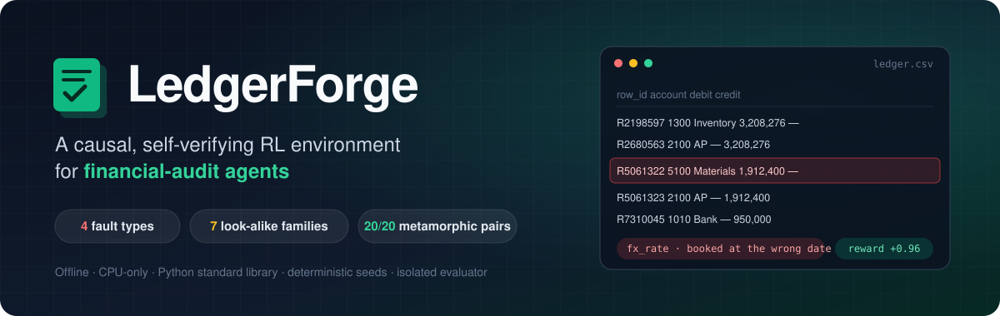
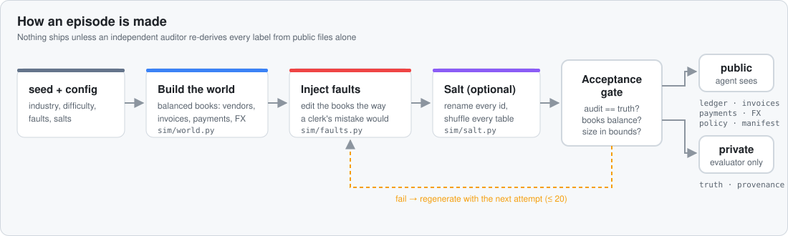
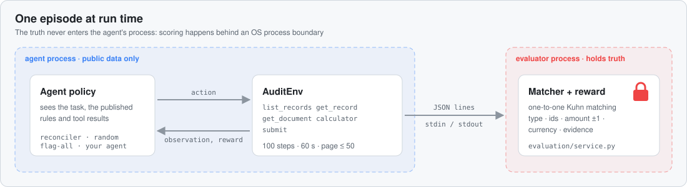
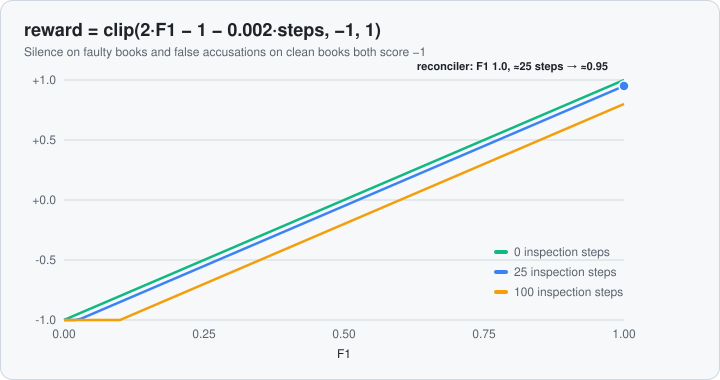
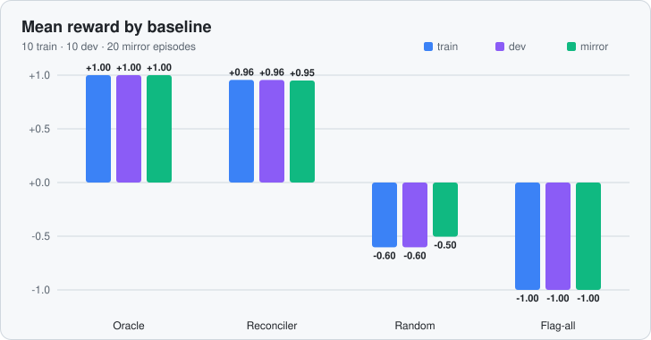
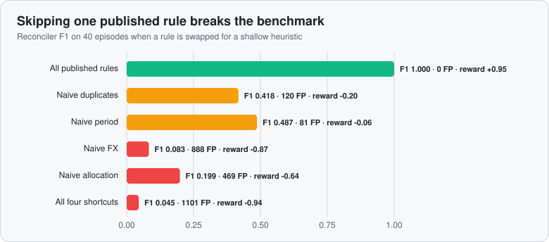

<p align="center">
  
</p>

<p align="center">
  
  
  
  <a href="LICENSE"></a>
</p>

<p align="center"><strong>English</strong> · <a href="README.ru.md">Русский</a></p>

# LedgerForge

LedgerForge is a reinforcement-learning environment for financial audits. A policy investigates a
fictional company's quarter through five tools and submits findings with evidence. The generator
creates balanced books and injects faults by changing the underlying records. An independent
auditor must recover every injected fault from the public records before the episode is accepted.
A separate evaluator process scores the policy's findings.

Built for the FinTech track of REC Genesis Hackathon 2026. All companies, people, and amounts are
synthetic. Evaluation runs offline on a CPU using the Python standard library.

[Quick start](#quick-start) · [Episode generation](#episode-generation) ·
[Agent interface](#agent-interface) · [Benchmark results](#benchmark-results) ·
[Dataset](#dataset) · [Reproducibility](#reproducibility)

## Quick start

Use Python 3.11 and uv 0.11, or run the Docker image.

```bash
make verify       # Sync the lockfile, lint, run the tests, and replay three oracle episodes
make walkthrough  # Eight-step demo on a construction-company episode
make bench        # Run the four baselines, 20 paired checks, and failure analysis
make ablation     # Measure the effect of replacing published rules with shortcuts
make figures      # Regenerate the three charts from committed reports
```

`make verify` ends with three oracle episodes scoring `1.000` and replaying identically.

```bash
docker build -t ledgerforge .
docker run --rm --network none ledgerforge
```

The container command runs the test suite and replay demo with networking disabled.

## Walkthrough

```bash
make walkthrough
# Or select a seed:
uv run python -m ledgerforge.walkthrough --seed 2006
```

The default demo follows an invoice from the ledger to its payment. The reconciler takes
**21 steps** (20 page reads and a submission) and finds a duplicate invoice and a related payment
allocation fault. The runner shows private truth in its own view, then shows the submitted
evidence, the evaluator's score, and what changes when IDs and table order are transformed.

| Policy or run | Reward | True positives | False positives | False negatives |
|---|---:|---:|---:|---:|
| Reconciler | +0.960 | 2 | 0 | 0 |
| Flag-all | −1.000 | 0 | 30 | 2 |
| Oracle | +1.000 | 2 | 0 | 0 |
| Reconciler after ID renaming and row shuffling | +0.960 | 2 | 0 | 0 |

The walkthrough exits with an error if the reconciler's reward changes after the transformation.

## Episode generation



1. A seed and scenario config produce balanced double-entry books for one accounts-payable quarter.
2. Faults are injected by editing invoices, payment postings, rates, or dates. Private provenance
   records the original and changed values.
3. Optional salts rename IDs and shuffle the order of public records. Transformed episodes go
   through the acceptance gate as well.
4. The independent auditor reads the public files and rules. Its findings must match the private
   fault labels on type, affected documents, amount, and currency. Each required evidence ID must
   resolve to a public record and be derivable by the auditor.
5. The gate also checks balanced journals, **200–2,000 ledger rows**, and **20–200 documents**.
   Generation retries with the next attempt index, up to 20 attempts.

The generator and auditor implement the accounting checks separately and share the money,
FX lookup, and local-date primitives in `contracts/money.py`.
[Architecture](docs/ARCHITECTURE.md) · [Design note](docs/DESIGN_NOTE.md) ·
[Contracts](docs/CONTRACTS.md) · [Engineering decisions](docs/DECISIONS.md)

### The simulated company

Each company has 7–12 suppliers. The industries are industrial procurement, construction,
manufacturing, and retail services. The supported currencies are KZT, USD, EUR, CNY, RUB, JPY,
and KWD. Default invoice counts range from 30 to 100, with 1–6 line items per invoice. Difficulty
scales the ledger to approximately 200, 400, 800, or 1,600 rows, including routine payroll,
depreciation, and bank-fee entries.

An invoice debits expense and credits accounts payable (AP). Settlement debits AP and credits the
bank account, with exchange differences recorded in account `7600`. Payments can settle an invoice
in instalments, cover multiple invoices, or remain unapplied as supplier advances.

<details>
<summary>Published accounting rules</summary>

Each episode's `policy.json` gives the recognition timezone and inclusive period bounds.
Recognition uses the local calendar date of the invoice issue or payment timestamp. FX rates
come from that date or the most recent earlier date when the rate table has a gap.

Amounts are integers in minor units, and the ledger uses the functional currency. Conversion
rounds half to even at the target currency's minor unit. Journal rows group by `payment_id`,
then `invoice_id`, then timestamp. For each remittance reference, expected AP relief is the
reference amount multiplied by the invoice's posted AP credit and divided by the invoice total,
rounded half to even.

</details>

### Faults and interactions

| Fault | Change to the books | Affected documents | Expected amount in functional currency |
|---|---|---|---|
| `duplicate_invoice` | Post a second invoice for the same supplier, currency, total, and line items under a variant number | Original and duplicate | AP credit of the later copy |
| `payment_allocation` | Post all or part of the intended AP relief to a different invoice or to advances | Payment and intended invoice | Expected AP relief minus recorded relief |
| `fx_rate` | Post an invoice at the rate for a different date | Invoice | Absolute difference between the posted and correct AP |
| `reporting_period` | Post an invoice in the current period when its recognition date falls outside it | Invoice | Posted AP |

The `duplicate_with_allocation` interaction links a duplicate to a misallocated payment.
The `fx_with_period` interaction combines an FX error and a period error on one invoice.
Allocation faults cover missing, partial, and misapplied amounts, including foreign-currency payments.
Injection preconditions limit cascades, and the gate verifies the resulting labels.

<details>
<summary>Seven legitimate look-alike families</summary>

| Look-alike | Evidence that resolves it |
|---|---|
| Recurring monthly service | Equal amounts for the same vendor cover different service months in the line items. |
| Credit note and reissue | The credit note cancels the original charge. |
| Instalment payments | Partial remittances each relieve their share of AP. |
| Multi-invoice remittance | The remittance explicitly allocates one payment to several invoices. |
| Supplier advance | A payment without an invoice reference can legitimately remain in account `2190`. |
| Timezone-boundary invoice | The recognition date is inside the period in the published timezone. |
| Early next-period invoice | The document was received and is awaiting posting in its own period. |

</details>

## Agent interface



```python
from ledgerforge.env.env import AuditEnv

env = AuditEnv("train")
try:
    observation, info = env.reset(
        seed=7, config={"faults": {"fx_rate": 1}, "difficulty": "advanced"}
    )
    observation, reward, terminated, truncated, info = env.step(
        {"tool": "list_records", "args": {"table": "invoices", "limit": 50}}
    )
finally:
    env.close()
```

The reset observation includes the task, manifest, published policy, table sizes, tool names,
and remaining steps. The tools return detached snapshots, and saved actions and observations
are copied for replay.

| Tool | Arguments | Result |
|---|---|---|
| `list_records` | `table`, optional `cursor` and `limit` ≤ 50 | Rows and the next cursor |
| `get_record` | `table`, `id` | A row by `row_id`, `invoice_id`, `payment_id`, or the FX key `date:SRC:TGT` |
| `get_document` | `doc_id` | An invoice, payment, `manifest`, or `policy` |
| `calculator` | `expression`, up to 256 characters | Decimal arithmetic with `+ - * /` and parentheses |
| `submit` | `{episode_id, findings}` | Terminates the episode |

An episode allows **100 steps**, including submission, and **60 seconds**. Tool errors return
bounded error observations, and truncation scores an empty submission. Evaluator requests have a
10-second timeout. In evaluation mode, the evaluator acknowledges submission and makes scores
available to the trusted runner at the reporting stage.

Configuration covers industry, difficulty (`basic`, `intermediate`, `advanced`, `expert`), base
currency, counts by fault or interaction, distractors, an optional `n_invoices` between 20 and 100,
and the ID and order salts. See the [environment contract](docs/CONTRACTS.md).

<details>
<summary>Example submission from the reconciler</summary>

```json
{
  "episode_id": "EP-029cb5604418",
  "findings": [
    {
      "type": "fx_rate",
      "affected_ids": ["DOC-67555176"],
      "claimed_amount_minor": 14165109,
      "currency": "KZT",
      "evidence_ids": ["DOC-67555176", "R9791008", "2026-02-04:JPY:KZT"],
      "explanation": "Posted value differs from the published recognition-date rate."
    }
  ]
}
```

This is the seed 7 example above. It returned **0.948** after 26 inspection steps, with one true
positive and zero false positives or false negatives.

A submission accepts up to 30 findings. Each finding has 1–10 affected IDs, 0–10 evidence IDs, and
an explanation up to 1,000 characters. Evidence can identify a document, ledger row, or FX record.
Business IDs are normalized to document IDs. ID lists are treated as sets, and casing is ignored
for the fault type and currency. Extra keys, a mismatched episode ID, and floating-point or Boolean
amounts make a submission malformed.

</details>

## Scoring and isolation

```text
F1     = 2 × TP / (2 × TP + FP + FN)
reward = clip(2 × F1 − 1 − 0.002 × inspection_steps, −1, 1)
```



A true positive must match the fault type, affected documents, and currency, state the correct
absolute amount within one minor unit, and cite a complete accepted evidence set. The evaluator
uses deterministic one-to-one maximum matching (Kuhn's algorithm). Duplicate findings count as
false positives. Explanations carry no scoring weight. An empty submission on clean books yields
F1 of 1. A malformed submission yields reward −1.

In the walkthrough, two true positives, zero false positives, and 20 inspection steps give
`2 × 1 − 1 − 0.002 × 20 = 0.960`. The flag-all baseline's 30 false positives yield F1 of 0
and a reward clipped to −1.

The evaluator owns private truth and communicates with the environment over JSON lines. Policy
import checks, malformed-request tests, duplicate and ordering tests, reward-withholding tests,
and timeout tests exercise these boundaries. The evaluator and policy run under the same OS user
in the local setup. For untrusted policies, run the policy in a separate sandbox.
[Scoring details](docs/EVALUATION.md) · [Isolation details](docs/SECURITY.md)

## Benchmark results



The benchmark contains **10 train**, **10 dev**, and **20 local evaluation mirror** episodes. The
mirror covers four industries, four difficulties, KZT, USD, EUR, clean episodes, and both fault
interactions. The four baselines share the same case recipes and scoring rules.

| Policy | What it does | Train mean F1 | Dev mean F1 | Dev mean reward | Mirror mean F1 | Mirror mean reward |
|---|---|---:|---:|---:|---:|---:|
| Oracle | Trusted upper bound that submits the private findings | 1.000 | 1.000 | 1.000 | 1.000 | 1.000 |
| Reconciler | Reads public tables and applies the published rules | 1.000 | 1.000 | 0.955 | 1.000 | 0.950 |
| Random explorer | Reads up to eight randomly selected pages and submits an empty list | 0.200 | 0.200 | −0.603 | 0.250 | −0.504 |
| Flag-all | Submits up to 30 guesses | 0.000 | 0.000 | −1.000 | 0.000 | −1.000 |

The reconciler found **71 true positives, zero false positives, and zero false negatives** across
the 40 cases. It averaged between 22.20 and 25.05 inspections across the three splits. This result
measures how well a policy that already encodes the published rules can recover the labels. The
random explorer's nonzero mean F1 comes from clean episodes.

[Summary](outputs/benchmarks/summary.md) · [Per-episode metrics](outputs/benchmarks/metrics.json) ·
[Public trajectories](outputs/benchmarks/trajectories.jsonl) ·
[Failure analysis](outputs/reports/failure_analysis.md)

### Rule ablation



On the same 40 episodes, the combined shortcut policy averaged **0.045 F1** and **−0.939 reward**.
Each individual shortcut lowered mean reward below zero. The results show which legitimate
transactions expose each shortcut.

<details>
<summary>Full ablation results</summary>

| Rule replaced by a shortcut | TP | FP | FN | Mean F1 | Mean reward |
|---|---:|---:|---:|---:|---:|
| All published rules retained | 71 | 0 | 0 | 1.000 | 0.953 |
| Match duplicates on supplier and total | 71 | 120 | 0 | 0.418 | −0.201 |
| Use the printed date for the reporting period | 71 | 81 | 0 | 0.487 | −0.064 |
| Value invoices at the period-end FX rate | 40 | 888 | 31 | 0.083 | −0.866 |
| Value remittance allocations at the payment-date rate | 64 | 469 | 7 | 0.199 | −0.640 |
| Apply all four shortcuts | 27 | 1,101 | 44 | 0.045 | −0.939 |

</details>

[Committed ablation report](outputs/reports/ablation.md)

## Dataset

The train and dev directories contain 10 public episodes each. Their seeds and configurations are
listed in [splits.json](episodes/splits.json). The sets cover clean books, each fault, both
interactions, all difficulties, and an expert scenario with 10 injected issues.

<details>
<summary>Public file layout</summary>

| File | Contents |
|---|---|
| `manifest.json` | Episode ID, versions, functional currency, reporting period, timezone, and counts |
| `policy.json` | Published accounting and inspection rules |
| `ledger.csv` | Journal row IDs, timestamps, accounts, debit and credit amounts, currency, and references |
| `invoices.jsonl` | Documents, invoice numbers, suppliers, issue and due dates, currencies, totals, and line items |
| `payments.jsonl` | Documents, payment IDs, timestamps, currencies, amounts, and remittance references |
| `fx.csv` | Rate dates, source and target currencies, and rates |

```csv
row_id,timestamp,account,debit_minor,credit_minor,currency,entity_id,invoice_id,payment_id
R2198597,2026-01-01T06:11:40+05:00,1300 Inventory,320827681,0,KZT,V-6230,SF-3011,
R2680563,2026-01-01T06:11:40+05:00,2100 Accounts Payable,0,320827681,KZT,V-6230,SF-3011,
```

</details>

```bash
uv run ledgerforge release
uv run ledgerforge generate --seed 3 --count 2 --config '{"faults":{"fx_rate":1}}'
uv run ledgerforge audit episodes/train/EP-25c6213e4fb8
```

Generation writes truth and provenance to the ignored `private/` directory. See the
[public schemas](schemas/) and [data contract](docs/CONTRACTS.md).

## Reproducibility

- The same seed and config reproduce byte-identical public episodes under Python 3.11. The
  release test regenerates every committed train and dev episode and compares its files.
- All **20 of 20** paired ID and order transformations preserve public record content after
  applying the ID mapping, preserve oracle findings and reward, and pass deterministic replay.
- Benchmark reruns reproduce trajectory bytes and metrics apart from elapsed runtime. The runner
  publishes the three benchmark artifacts after the paired checks succeed.

```bash
uv run ledgerforge release
git diff --exit-code -- episodes/
make verify
```

## Engineering process

The published contracts define data, tools, matching, and scoring before implementation. Changes
are developed on separate branches, reviewed against the contract, and checked with
`make verify` before integration. The [decision records](docs/DECISIONS.md) explain the accounting
and isolation choices, including the unit correction for foreign-currency allocation faults
in ADR-015.

<details>
<summary>Repository layout</summary>

| Path | Role |
|---|---|
| `src/ledgerforge/contracts/` | Data shapes, money and time semantics, submission validation |
| `src/ledgerforge/sim/` and `src/ledgerforge/verification/` | Company generation, fault injection, salting, episode files, independent audit |
| `src/ledgerforge/env/` and `src/ledgerforge/evaluation/` | Agent tools, isolated evaluator, matching, reward |
| `src/ledgerforge/agents/` | Baselines and oracle |
| `src/ledgerforge/benchmark/` | Benchmarking, ablation, failure analysis, replay, chart generation |
| `src/ledgerforge/walkthrough.py` | Scripted demo |
| `schemas/`, `episodes/`, `outputs/`, `docs/`, `tests/` | Schemas, public cases, measured reports, documentation, verification |

</details>

## Limitations

Each fault currently has one minimal accepted evidence set, and an alternative proof may earn
zero credit. The chart of accounts covers accounts payable. Higher difficulties add mostly
routine ledger rows. The rule-based reconciler reaches the ceiling of the current case set.
Future extensions include external policy adapters, receivables and VAT faults, and episodes in
which the policy must request documents as needed.

## License and dependencies

LedgerForge is [MIT licensed](LICENSE). The runtime uses the Python standard library. Development
and test dependencies (`pytest`, `ruff`, `jsonschema`) are pinned in `uv.lock`.
See [third-party notices](THIRD_PARTY_NOTICES.md).
