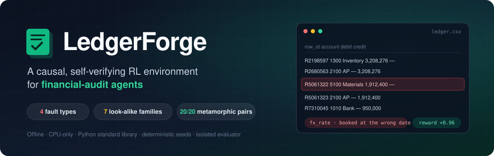
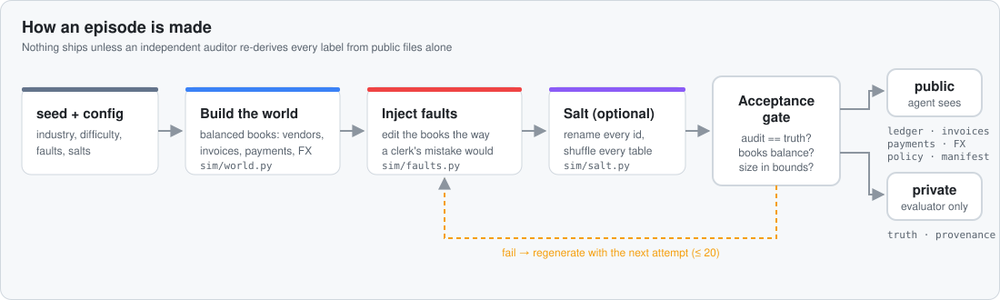
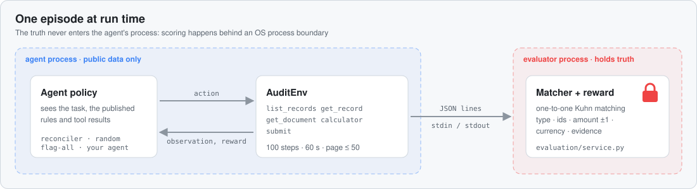
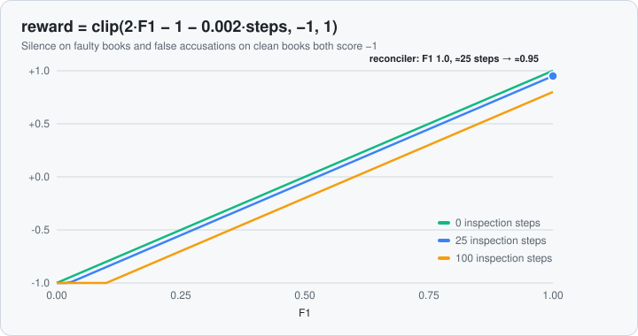
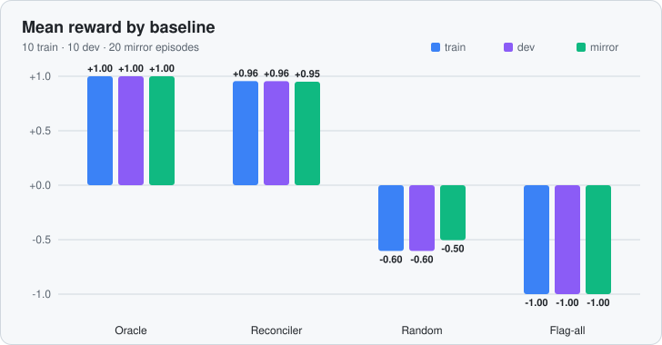
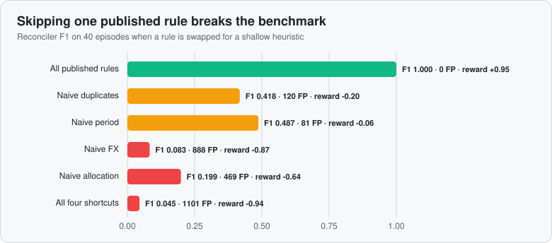

<p align="center">
  
</p>

<p align="center">
  
  
  
  <a href="LICENSE"></a>
</p>

<p align="center"><a href="README.md">English</a> · <strong>Русский</strong></p>

# LedgerForge

LedgerForge — среда обучения с подкреплением для финансового аудита. Агент проверяет квартал
вымышленной компании через пять инструментов и подаёт выводы с доказательствами. Генератор
формирует сбалансированный учёт и вносит ошибки в сами записи. Независимый аудитор должен
восстановить все внесённые ошибки по открытым данным, прежде чем эпизод будет принят. Выводы
агента оцениваются в отдельном процессе.

Проект создан для трека FinTech хакатона REC Genesis Hackathon 2026. Компании, люди и суммы
синтетические. Проверка выполняется без сети на CPU средствами стандартной библиотеки Python.

[Быстрый старт](#быстрый-старт) · [Генерация эпизода](#генерация-эпизода) ·
[Интерфейс агента](#интерфейс-агента) · [Результаты бенчмарка](#результаты-бенчмарка) ·
[Набор данных](#набор-данных) · [Воспроизводимость](#воспроизводимость)

## Быстрый старт

Для локального запуска нужны Python 3.11 и uv 0.11. Также доступен запуск через Docker.

```bash
make verify       # Установить зависимости, проверить код, запустить тесты и повторить три эпизода оракула
make walkthrough  # Демонстрация из восьми шагов на примере строительной компании
make bench        # Четыре базовые политики, 20 парных проверок и анализ ошибок
make ablation     # Измерить эффект замены опубликованных правил упрощениями
make figures      # Перестроить три графика из сохранённых отчётов
```

В конце `make verify` три эпизода оракула получают награду `1.000` и повторяются с тем же результатом.

```bash
docker build -t ledgerforge .
docker run --rm --network none ledgerforge
```

Команда запускает тесты и демонстрацию повтора эпизодов в контейнере с отключённой сетью.

## Демонстрация

```bash
make walkthrough
# Или явно выбрать seed:
uv run python -m ledgerforge.walkthrough --seed 2006
```

Демонстрация прослеживает путь счёта от записи в регистре до оплаты. Политика сверки за
**21 шаг** (20 запросов страниц и отправка результата) находит дубликат счёта и связанную
ошибку распределения платежа. Сценарий показывает закрытый эталон со стороны проверяющей
программы, представленные доказательства, оценку и результат после смены идентификаторов
и порядка записей.

| Политика или запуск | Награда | Верные выводы | Ложные выводы | Пропуски |
|---|---:|---:|---:|---:|
| Сверка по правилам | +0.960 | 2 | 0 | 0 |
| Массовая пометка | −1.000 | 0 | 30 | 2 |
| Оракул | +1.000 | 2 | 0 | 0 |
| Сверка после смены идентификаторов и порядка строк | +0.960 | 2 | 0 | 0 |

Команда завершается с ошибкой, если после преобразования меняется награда политики сверки.

## Генерация эпизода



1. Seed и настройки сценария задают квартал расчётов с поставщиками. Книги формируются по
   принципу двойной записи.
2. Ошибки вносятся изменением счёта, распределения платежа, курса или даты. Закрытая история
   изменений хранит исходные и изменённые значения.
3. По заданным параметрам можно переименовать идентификаторы и перемешать открытые строки.
   Преобразованный эпизод также проходит проверку.
4. Независимый аудитор читает открытые файлы и опубликованные правила. Его выводы должны
   совпадать с закрытым эталоном по типу ошибки, затронутым документам, сумме и валюте.
   Каждый обязательный идентификатор доказательства должен вести к открытой записи, связь
   с которой аудитор может вывести самостоятельно.
5. Проверка подтверждает баланс проводок, **200–2 000 строк регистра** и **20–200 документов**.
   При расхождении генератор использует следующий номер попытки, всего до 20 попыток.

Генератор и аудитор реализуют бухгалтерские проверки отдельно. Оба используют функции
работы с деньгами, курсами и локальными датами из `contracts/money.py`.
[Архитектура](docs/ARCHITECTURE.md) · [Описание проекта](docs/DESIGN_NOTE.md) ·
[Контракты](docs/CONTRACTS.md) · [Инженерные решения](docs/DECISIONS.md)

### Модель компании

У каждой компании 7–12 поставщиков. Поддерживаются промышленные закупки, строительство,
производство и розничные услуги. Валюты — KZT, USD, EUR, CNY, RUB, JPY и KWD. По умолчанию
генерируется от 30 до 100 счетов, в каждом от 1 до 6 позиций. Уровень сложности определяет
объём регистра: примерно 200, 400, 800 или 1 600 строк, включая зарплату, амортизацию
и банковские комиссии.

Проводка счёта отражает расходы по дебету и кредиторскую задолженность (КЗ) по кредиту.
При оплате дебетуется КЗ и кредитуется банковский счёт, а курсовая разница отражается
на счёте `7600`. Платежи могут погашать счёт частями, покрывать несколько счетов или
оставаться нераспределёнными как аванс поставщику.

<details>
<summary>Опубликованные правила учёта</summary>

Файл `policy.json` задаёт часовой пояс признания операции и включительные границы периода.
Для счёта берётся локальная дата выставления, для платежа — локальная дата его проведения.
Курс берётся за соответствующий день или за ближайшую предшествующую дату при пропуске
в таблице курсов.

Суммы хранятся целыми числами в минимальных денежных единицах. Регистр ведётся в
функциональной валюте. При конвертации используется округление до чётного в минимальных
единицах целевой валюты. Строки проводок группируются сначала по `payment_id`, затем
по `invoice_id`, затем по отметке времени. Ожидаемое погашение КЗ для каждой ссылки в платеже
равно сумме по ссылке, умноженной на проведённый кредит КЗ по счёту и разделённой на общую
сумму счёта. Результат округляется до чётного.

</details>

### Ошибки и их сочетания

| Ошибка | Изменение в учёте | Затронутые документы | Ожидаемая сумма в функциональной валюте |
|---|---|---|---|
| `duplicate_invoice` | Повторно проводится счёт с тем же поставщиком, валютой, суммой и позициями под изменённым номером | Исходный счёт и дубликат | Кредит КЗ по поздней копии |
| `payment_allocation` | Часть или вся сумма погашения КЗ относится на другой счёт или на авансы | Платёж и целевой счёт | Ожидаемое погашение КЗ минус проведённое |
| `fx_rate` | Счёт проводится по курсу за другую дату | Счёт | Абсолютная разница между проведённой и верной суммой КЗ |
| `reporting_period` | Счёт проводится в текущем периоде, хотя дата признания выходит за его границы | Счёт | Проведённая сумма КЗ |

Сочетание `duplicate_with_allocation` связывает дубликат с неверно распределённым платежом.
`fx_with_period` совмещает ошибку курса и ошибку периода на одном счёте. Ошибки распределения
включают пропущенное, частичное и ошибочное отнесение суммы, в том числе платежи в
иностранной валюте. Условия внесения ошибок ограничивают цепные эффекты, а проверка
подтверждает итоговые метки.

<details>
<summary>Семь семейств корректных операций, похожих на ошибки</summary>

| Операция | Как её распознать |
|---|---|
| Периодические услуги | Одинаковые суммы у одного поставщика относятся к разным месяцам, указанным в позициях счёта. |
| Кредит-нота и перевыставление | Кредит-нота аннулирует исходное начисление. |
| Оплата частями | Каждый частичный платёж погашает свою долю КЗ. |
| Оплата нескольких счетов | Назначение платежа явно распределяет сумму по счетам. |
| Аванс поставщику | Платёж без ссылки на счёт может обоснованно учитываться на счёте `2190`. |
| Счёт на границе часовых поясов | В опубликованном часовом поясе дата признания попадает в период. |
| Заранее полученный счёт следующего периода | Документ получен и ожидает проведения в своём периоде. |

</details>

## Интерфейс агента



```python
from ledgerforge.env.env import AuditEnv

env = AuditEnv("train")
try:
    observation, info = env.reset(
        seed=7, config={"faults": {"fx_rate": 1}, "difficulty": "advanced"}
    )
    observation, reward, terminated, truncated, info = env.step(
        {"tool": "list_records", "args": {"table": "invoices", "limit": 50}}
    )
finally:
    env.close()
```

Первое наблюдение содержит задачу, манифест, опубликованные правила, размеры таблиц,
названия инструментов и число оставшихся шагов. Инструменты возвращают копии данных.
В журнал повтора также записываются отдельные копии действий и наблюдений.

| Инструмент | Аргументы | Результат |
|---|---|---|
| `list_records` | `table`, необязательные `cursor` и `limit` ≤ 50 | Строки и курсор следующей страницы |
| `get_record` | `table`, `id` | Строка по `row_id`, `invoice_id`, `payment_id` или ключу курса `date:SRC:TGT` |
| `get_document` | `doc_id` | Счёт, платёж, `manifest` или `policy` |
| `calculator` | `expression` до 256 символов | Десятичная арифметика с `+ - * /` и скобками |
| `submit` | `{episode_id, findings}` | Завершает эпизод |

Эпизод ограничен **100 шагами**, включая отправку результата, и **60 секундами**. Ошибка
инструмента возвращается в наблюдении. При исчерпании лимита оценивается пустая заявка.
Тайм-аут одного запроса к оценщику составляет 10 секунд. В режиме оценки процесс подтверждает
приём заявки, а баллы получает проверяющая программа на этапе отчёта.

Настройки задают отрасль, сложность (`basic`, `intermediate`, `advanced`, `expert`),
функциональную валюту, количество ошибок и сочетаний, наличие похожих корректных операций,
необязательное число счетов `n_invoices` от 20 до 100 и параметры смены идентификаторов
и порядка строк. Подробнее в [контракте среды](docs/CONTRACTS.md).

<details>
<summary>Пример заявки политики сверки</summary>

```json
{
  "episode_id": "EP-029cb5604418",
  "findings": [
    {
      "type": "fx_rate",
      "affected_ids": ["DOC-67555176"],
      "claimed_amount_minor": 14165109,
      "currency": "KZT",
      "evidence_ids": ["DOC-67555176", "R9791008", "2026-02-04:JPY:KZT"],
      "explanation": "Posted value differs from the published recognition-date rate."
    }
  ]
}
```

Это результат примера выше с seed 7. Награда составила **0.948** после 26 шагов проверки:
один верный вывод, ноль ложных выводов и ноль пропусков.

Заявка содержит до 30 выводов. В каждом допустимо 1–10 идентификаторов затронутых объектов,
0–10 идентификаторов доказательств и пояснение длиной до 1 000 символов. Доказательством
может быть документ, строка регистра или запись курса. Бизнес-идентификаторы преобразуются
в идентификаторы документов. Списки идентификаторов проверяются как множества. Регистр
символов типа ошибки и валюты игнорируется. Лишние ключи, чужой идентификатор эпизода и
сумма с плавающей точкой или логическим значением нарушают формат заявки.

</details>

## Оценка и изоляция

```text
F1      = 2 × TP / (2 × TP + FP + FN)
награда = clip(2 × F1 − 1 − 0.002 × inspection_steps, −1, 1)
```



Верный вывод должен совпадать с эталоном по типу ошибки, затронутым документам и валюте,
указывать верную абсолютную сумму с допуском в одну минимальную единицу и ссылаться на
полный допустимый набор доказательств. Оценщик использует детерминированное максимальное
взаимно-однозначное сопоставление по алгоритму Куна. Повторный вывод считается ложным
срабатыванием. Текст пояснения не влияет на балл. Пустая заявка на чистых книгах даёт
F1, равный 1. Ошибка формата заявки даёт награду −1.

В демонстрации два верных вывода, ноль ложных срабатываний и 20 шагов дают
`2 × 1 − 1 − 0.002 × 20 = 0.960`. У политики массовой пометки 30 ложных выводов,
F1 равен 0, а награда ограничивается значением −1.

Закрытый эталон хранится в процессе оценивания, который обменивается со средой строками JSON.
Тесты проверяют изоляцию импортов политики, обработку некорректных запросов, повторные выводы,
перестановку порядка, скрытие награды в режиме оценки и тайм-ауты. При локальном запуске
политика и оценщик работают от одного пользователя ОС. Для недоверенной политики используйте
отдельную песочницу. [Подробности оценки](docs/EVALUATION.md) ·
[Подробности изоляции](docs/SECURITY.md)

## Результаты бенчмарка



В бенчмарке **10 обучающих**, **10 проверочных** и **20 локальных оценочных** эпизодов.
Локальная оценочная выборка охватывает четыре отрасли, четыре сложности, KZT, USD и EUR,
чистые эпизоды и оба сочетания ошибок. Все четыре базовые политики используют одинаковые
рецепты эпизодов и правила оценки.

| Политика | Поведение | Средний F1, train | Средний F1, dev | Средняя награда, dev | Средний F1, mirror | Средняя награда, mirror |
|---|---|---:|---:|---:|---:|---:|
| Оракул | Верхняя граница с доступом к закрытому эталону | 1.000 | 1.000 | 1.000 | 1.000 | 1.000 |
| Сверка по правилам | Читает открытые таблицы и применяет опубликованные правила | 1.000 | 1.000 | 0.955 | 1.000 | 0.950 |
| Случайный обход | Читает до восьми случайных страниц и подаёт пустую заявку | 0.200 | 0.200 | −0.603 | 0.250 | −0.504 |
| Массовая пометка | Подаёт до 30 предположений | 0.000 | 0.000 | −1.000 | 0.000 | −1.000 |

На 40 эпизодах политика сверки получила **71 верный вывод, ноль ложных выводов и ноль
пропусков**. Среднее число шагов проверки по выборкам составляет от 22.20 до 25.05.
Результат показывает, насколько полно политика с уже заданными правилами восстанавливает
метки. Ненулевой средний F1 случайного обхода обеспечивают чистые эпизоды.

[Сводка](outputs/benchmarks/summary.md) ·
[Метрики по эпизодам](outputs/benchmarks/metrics.json) ·
[Открытые траектории](outputs/benchmarks/trajectories.jsonl) ·
[Анализ ошибок](outputs/reports/failure_analysis.md)

### Абляция правил



На тех же 40 эпизодах комбинация четырёх упрощений получила средний **F1 0.045** и среднюю
**награду −0.939**. Каждое отдельное упрощение снизило среднюю награду ниже нуля.
Результаты показывают, какие корректные операции выявляют слабость каждого упрощения.

<details>
<summary>Полные результаты абляции</summary>

| Правило, заменённое упрощением | TP | FP | FN | Средний F1 | Средняя награда |
|---|---:|---:|---:|---:|---:|
| Все опубликованные правила сохранены | 71 | 0 | 0 | 1.000 | 0.953 |
| Дубликаты ищутся по поставщику и сумме | 71 | 120 | 0 | 0.418 | −0.201 |
| Период определяется по дате на документе | 71 | 81 | 0 | 0.487 | −0.064 |
| Счета оцениваются по курсу на конец периода | 40 | 888 | 31 | 0.083 | −0.866 |
| Распределение платежей оценивается по курсу на дату оплаты | 64 | 469 | 7 | 0.199 | −0.640 |
| Применены все четыре упрощения | 27 | 1 101 | 44 | 0.045 | −0.939 |

</details>

[Сохранённый отчёт об абляции](outputs/reports/ablation.md)

## Набор данных

В каталогах train и dev по 10 открытых эпизодов. Seed и настройки записаны в
[splits.json](episodes/splits.json). Выборки включают чистые книги, все типы ошибок, оба
сочетания, все уровни сложности и экспертный сценарий с 10 внесёнными ошибками.

<details>
<summary>Структура открытых файлов</summary>

| Файл | Содержимое |
|---|---|
| `manifest.json` | Идентификатор эпизода, версии, функциональная валюта, период, часовой пояс и размеры таблиц |
| `policy.json` | Опубликованные правила учёта и проверки |
| `ledger.csv` | Идентификаторы строк, время, счета, суммы по дебету и кредиту, валюта и ссылки |
| `invoices.jsonl` | Документы, номера счетов, поставщики, даты выставления и оплаты, валюты, суммы и позиции |
| `payments.jsonl` | Документы, идентификаторы платежей, время, валюты, суммы и ссылки назначения |
| `fx.csv` | Даты, исходные и целевые валюты и курсы |

```csv
row_id,timestamp,account,debit_minor,credit_minor,currency,entity_id,invoice_id,payment_id
R2198597,2026-01-01T06:11:40+05:00,1300 Inventory,320827681,0,KZT,V-6230,SF-3011,
R2680563,2026-01-01T06:11:40+05:00,2100 Accounts Payable,0,320827681,KZT,V-6230,SF-3011,
```

</details>

```bash
uv run ledgerforge release
uv run ledgerforge generate --seed 3 --count 2 --config '{"faults":{"fx_rate":1}}'
uv run ledgerforge audit episodes/train/EP-25c6213e4fb8
```

Генератор записывает эталон и историю изменений в исключённый из Git каталог `private/`.
См. [открытые схемы](schemas/) и [контракт данных](docs/CONTRACTS.md).

## Воспроизводимость

- Один seed и одни настройки дают побайтно одинаковые открытые эпизоды в Python 3.11.
  Тест выпускной выборки заново генерирует все сохранённые эпизоды train и dev и сравнивает файлы.
- Все **20 из 20** парных проверок после смены идентификаторов и порядка строк подтверждают
  эквивалентность открытых данных с учётом отображения идентификаторов, выводы и награду
  оракула, а также детерминированный повтор.
- Повторный прогон бенчмарка даёт побайтно одинаковые траектории и одинаковые метрики,
  кроме времени выполнения. Три файла бенчмарка публикуются после успешных парных проверок.

```bash
uv run ledgerforge release
git diff --exit-code -- episodes/
make verify
```

## Инженерный процесс

Опубликованные контракты сначала определяют данные, инструменты, сопоставление и оценку.
Изменения разрабатываются в отдельных ветках, проходят проверку по контракту и
`make verify` перед объединением. [Записи об инженерных решениях](docs/DECISIONS.md)
объясняют принципы учёта и изоляции, включая исправление единиц измерения для ошибок
распределения платежей в иностранной валюте в ADR-015.

<details>
<summary>Структура репозитория</summary>

| Путь | Назначение |
|---|---|
| `src/ledgerforge/contracts/` | Форматы данных, правила работы с деньгами и временем, проверка заявки |
| `src/ledgerforge/sim/` и `src/ledgerforge/verification/` | Генерация компании, внесение ошибок, преобразования, файлы эпизода, независимый аудит |
| `src/ledgerforge/env/` и `src/ledgerforge/evaluation/` | Инструменты, отдельный процесс оценки, сопоставление и награда |
| `src/ledgerforge/agents/` | Базовые политики и оракул |
| `src/ledgerforge/benchmark/` | Бенчмарк, абляция, анализ ошибок, повтор траекторий, построение графиков |
| `src/ledgerforge/walkthrough.py` | Демонстрационный сценарий |
| `schemas/`, `episodes/`, `outputs/`, `docs/`, `tests/` | Схемы, открытые эпизоды, отчёты, документация и проверки |

</details>

## Ограничения

Для каждой ошибки задан один минимальный допустимый набор доказательств. Альтернативное
обоснование может получить нулевой балл. План счетов ориентирован на расчёты с поставщиками.
На высоких уровнях сложности прибавляются преимущественно регулярные проводки. Политика
сверки по правилам достигает потолка текущего набора эпизодов. Возможные расширения включают
адаптеры внешних политик, ошибки дебиторской задолженности и НДС, а также эпизоды, где
документы выдаются агенту по запросу.

## Лицензия и зависимости

LedgerForge распространяется по [лицензии MIT](LICENSE). Среда использует стандартную библиотеку
Python. Зависимости разработки и тестирования (`pytest`, `ruff`, `jsonschema`) закреплены
в `uv.lock`. См. [сведения о сторонних компонентах](THIRD_PARTY_NOTICES.md).
